<picture>
  <source media="(prefers-color-scheme: dark)" srcset="https://raw.githubusercontent.com/Hii-Dev/Hii-Dev/output/hero-dark.svg">
  
</picture>

[Portfolio](https://hii-dev.vercel.app) · [Zenn](https://zenn.dev/aputech) · [note](https://note.com/h1idev) · [X](https://x.com/h1idev)

### About

- Kawahara Computer Business College / Sanno University (Class of 2026)
- Building web apps with Next.js and FastAPI
- Beer & books

### Stack

TypeScript · React · Next.js · Tailwind CSS · Python · FastAPI

 

<picture>
  <source media="(prefers-color-scheme: dark)" srcset="https://raw.githubusercontent.com/Hii-Dev/Hii-Dev/output/activity-dark.svg">
  
</picture>

<picture>
  <source media="(prefers-color-scheme: dark)" srcset="https://raw.githubusercontent.com/Hii-Dev/Hii-Dev/output/languages-dark.svg">
  
</picture>
