<picture><source media="(prefers-color-scheme: dark)" srcset="https://raw.githubusercontent.com/Hii-Dev/Hii-Dev/output/hero-dark.svg"></picture>

<a
href="https://hii-dev.vercel.app"><picture><source media="(prefers-color-scheme: dark)" srcset="https://raw.githubusercontent.com/Hii-Dev/Hii-Dev/output/link-portfolio-dark.svg"></picture></a><a
href="https://zenn.dev/aputech"><picture><source media="(prefers-color-scheme: dark)" srcset="https://raw.githubusercontent.com/Hii-Dev/Hii-Dev/output/link-zenn-dark.svg"></picture></a><a
href="https://note.com/h1idev"><picture><source media="(prefers-color-scheme: dark)" srcset="https://raw.githubusercontent.com/Hii-Dev/Hii-Dev/output/link-note-dark.svg"></picture></a><a
href="https://x.com/h1idev"><picture><source media="(prefers-color-scheme: dark)" srcset="https://raw.githubusercontent.com/Hii-Dev/Hii-Dev/output/link-x-dark.svg"></picture></a>

<picture><source media="(prefers-color-scheme: dark)" srcset="https://raw.githubusercontent.com/Hii-Dev/Hii-Dev/output/about-dark.svg"></picture>

<picture><source media="(prefers-color-scheme: dark)" srcset="https://raw.githubusercontent.com/Hii-Dev/Hii-Dev/output/stack-dark.svg"></picture>

<picture><source media="(prefers-color-scheme: dark)" srcset="https://raw.githubusercontent.com/Hii-Dev/Hii-Dev/output/activity-dark.svg"></picture>

<picture><source media="(prefers-color-scheme: dark)" srcset="https://raw.githubusercontent.com/Hii-Dev/Hii-Dev/output/languages-dark.svg"></picture>
